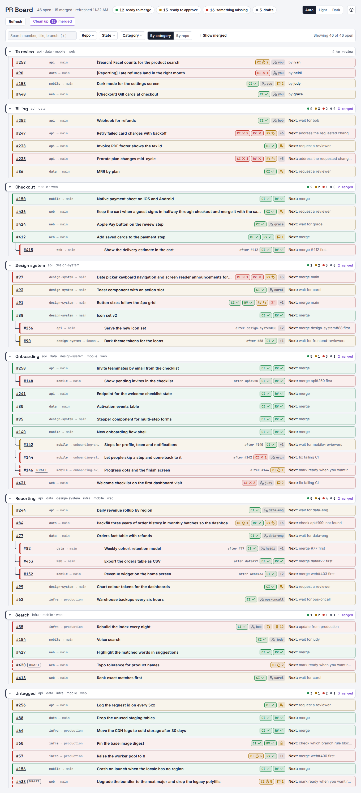
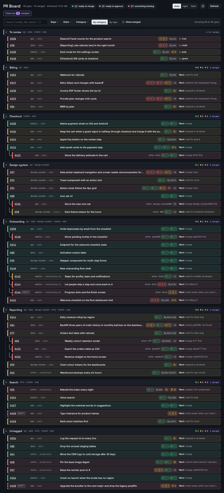
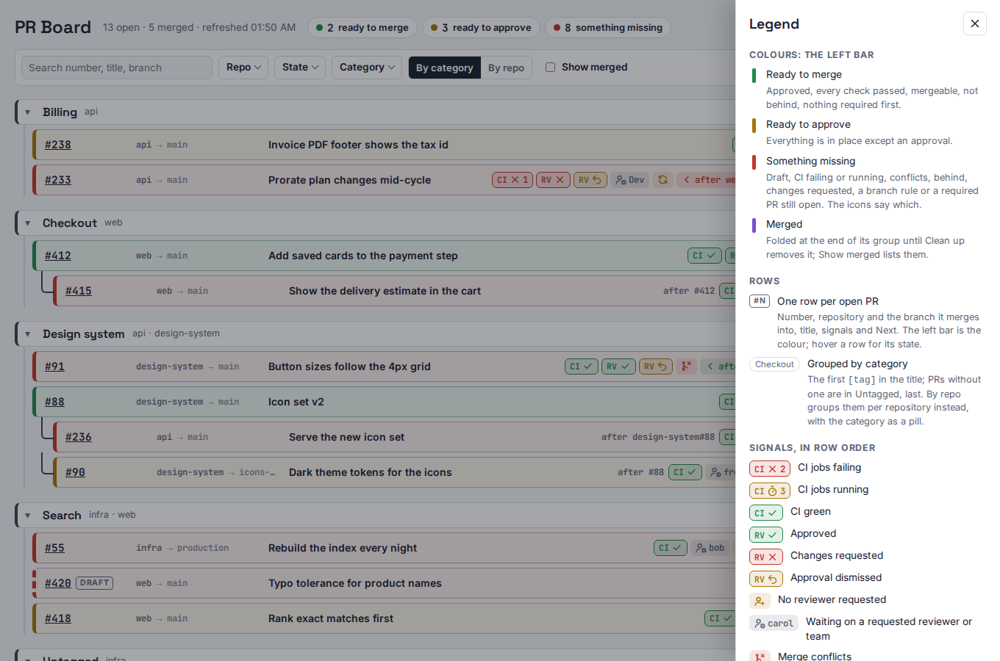
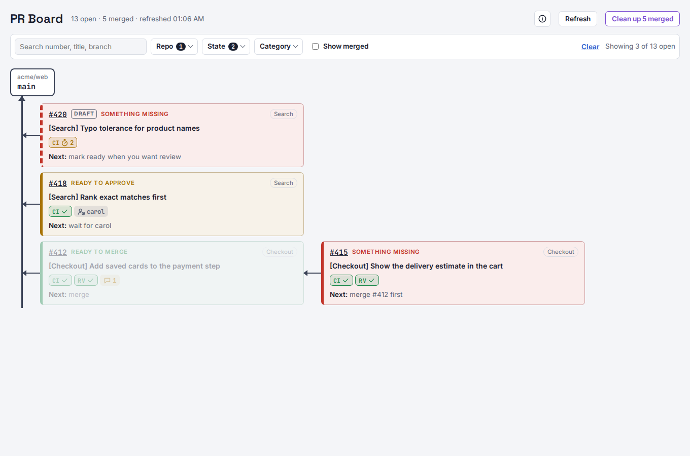
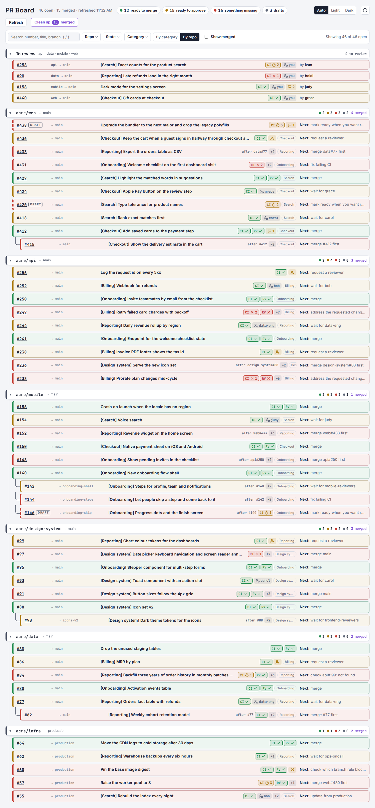

# PR Board

A local page that lists your open GitHub pull requests: one full-width row per PR, grouped by the category in its title (or by repository), each with a left bar coloured by what it still needs. A PR that waits on another, stacked or required, sits under it, across repositories too. Merged PRs fold at the end of their group until you clean them up. A small Go server (`pr-board`) collects the data with your `gh` login; an optional Claude Code plugin keeps it alive while sessions run. Everything on the board is derived from the PR itself; no model reads it.

## Screenshots

All screenshots come from `pr-board demo`, a fictional organization.











## What the page shows

The colour is the row's left bar:

| Colour | Meaning |
|---|---|
| green | Ready to merge: not a draft, approved, every check passed and none running, mergeable, not behind, no branch rule blocking, no changes requested, no required PR still open |
| yellow | Ready to approve: not a draft and everything above is in place except an approval |
| red | Something missing: any other open PR (draft, CI failing or running, conflicts, behind, changes requested, a branch rule, a required PR still open); the icons say what |
| purple | Merged, until Clean up removes it |

Every open row has the same height and five columns: the number (a DRAFT tag on drafts), the repository and the branch it merges into (`web → main`), the title on one line (the full title in its tooltip), one signals row at most 220px wide that never wraps (signals that do not fit fold into a `+N` chip whose tooltip names each hidden one and its detail) and the Next step. Hovering a row lifts it and names its state. A draft's left bar is dashed. Merged rows are shorter and purple. Under 700px wide each row takes two lines: number, repository and title, then signals and Next. The info button in the header opens the legend drawer, which lists the colours, the rows, every signal in row order and the chains. The Auto / Light / Dark switch next to it sets the theme: Auto follows the system, the other two are remembered in the browser.

The counters in the header (`● 2 ready to merge ● 3 ready to approve ● 8 something missing`) count your open PRs per colour; clicking one toggles that colour in the State filter. The tab title shows how many are ready to merge, `(2) PR Board`. Clean up shows the number of merged PRs it would clear as a badge, and is disabled when there are none.

### Groups

By default the rows are grouped by category: the first token in square brackets in the title (`[Checkout]`, `[Design system]`), each bracket split on `|`, skipping the repository's own name (`[web]`), issue keys (`[WEB-123]`) and `required:` lists. Categories are listed alphabetically and PRs without one go in **Untagged**, last. Each band shows the category, the repositories it spans, its colour counts and how many merged PRs are on the board; inside it the rows drop their own `[Category]` tag from the title. A band stays at the top of the window while you scroll through its group.

The By category / By repo switch in the filter bar groups them per repository instead: the band shows `owner/repo → branch`, the colour counts and how many merged PRs are on the board, each row shows only `→ branch`, and the category is a pill after the signals. Click a band to collapse it.

### To review

Open PRs by others that request your review (`review-requested:@me` in the configured owners) sit in one compact band above the groups, in both views: number, repository, title, signals and the author. The band states how many there are; they are not in the colour counters or the "Showing N of M" count, never join a chain, and Clean up never touches them. When the review is no longer requested or the PR closes, it leaves the board on the next refresh.

### Chains

A PR waits on another when its base is that PR's branch (a stack, same repository) or when its description requires an open PR on the board (`[required:...]`, any repository; when several qualify, the first). It is shown right under that PR, indented, with an elbow and an `after #412` or `after repo#90` label, and the required chip it would have repeated is dropped. When the PR it waits on is in another group, it stays in its own group with the label and no elbow.

The signals always come in the same order, so each one sits in the same place on every row. Each has a tooltip with the detail (which jobs fail, who approved, who dismissed):

| Signal | Shows |
|---|---|
| CI | the letters `CI` with a check (green), a cross and the failing count (red) or a stopwatch and the running count (amber) |
| Review | the letters `RV` with a check (approved), a cross (changes requested) or an undo arrow (approval dismissed); always right after CI, and both letter chips have a border in their colour so the two read apart |
| Reviewer | a person with a plus (no reviewer requested), or a person with a clock and the requested login or team, cut at about 12 characters |
| Conflicts | two branches joining, with a cross |
| Behind | sync arrows |
| Branch rule | a shield with a cross: approved and green, but a rule still blocks the merge |
| Required PRs | a left chevron and `after #412` or `after repo#90`, for requirements that are not a chain (see below) |
| Threads | a speech bubble and the count of unresolved threads |
| Stale | an hourglass and the days since the last update, after 10 |

### Filters

The bar under the header filters the rows on the page: a search over number, title and branch (`/` focuses it, Escape leaves it), Repo, State and Category (with "No category") multi-selects, and a Show merged switch (off by default; each group then gets a "N merged" fold that opens its merged rows). A chain is shown whole when any PR in it matches, with the others dimmed, so the merge order stays visible; a group with nothing left hides. "Showing N of M open" counts the matching open PRs, and Clear resets everything.

The filters, the grouping and the collapsed groups live in the URL fragment, so a link reproduces the view:

```text
http://127.0.0.1:<port>/#state=missing,approve&repo=web&q=checkout&cat=Checkout&merged=1&group=repo&rfold=infra
```

State values are `ready`, `approve` and `missing`; `cat=~none` is "No category". `group=repo` is the repository view (absent: by category). `fold` lists the collapsed category bands (`~none` is Untagged) and `rfold` the collapsed repository bands. Clear resets the filters and keeps the grouping and the collapsed bands.

### Required PRs

Name the PRs that must merge first anywhere in the description, outside fenced code:

```text
[required:acme/infra#478, acme:design-system#12, api#4021, #4543]
```

`owner/repo#N` and `owner:repo#N` are full references, `repo#N` uses the PR's owner, `#N` its repository. The keyword is case-insensitive, several blocks merge, and malformed items are skipped. An open PR on the board, in any repository, becomes the row's parent (see Chains; when several qualify, the first one, and the rest stay chips). Every other requirement is a chevron chip, "after repo#N", coloured by the target's state, which the collector looks up with one extra GraphQL query when the target is not on the board: green when merged, amber when open, red when closed without merging, amber "not found" when GitHub does not know it. Any requirement that is not merged makes the row red with "merge #N first".

## Install

```sh
GOBIN=$HOME/.local/bin go install ./cmd/pr-board     # from a clone
```

Needs `gh` logged in (`gh auth status`) and, for the session check-in and cleanup's live-session check, `claude` on `PATH`.

The Claude Code plugin lives in `plugin/`; the repository root is a one-plugin marketplace:

```sh
claude plugin marketplace add /path/to/pr-board
claude plugin install pr-board@pr-board
```

It adds a SessionStart hook and the `/pr-board` skill. The hook looks for `pr-board` on `PATH`, then in `~/.local/bin` and `~/go/bin`, and exits 0 without doing anything when it is missing.

## Usage

```sh
pr-board                              # same as pr-board up
pr-board up [--session ID] [--open]   # start the server or reuse the running one; prints its URL
pr-board refresh                      # collect from GitHub now
pr-board cleanup [--dry-run] [--yes]  # print the cleanup plan; without --dry-run ask y/N, then run it
pr-board status                       # pid, port, idle deadline, who checked in
pr-board stop
pr-board collect --json               # collect once without a server and print store, derived state and view
pr-board demo [--port N] [--open]     # serve the fictional demo board until Ctrl-C (also: pr-board --demo)
```

`refresh` and `cleanup` start the server when none runs; `status` and `stop` never do. `demo` needs no GitHub login and touches none of the files below: it runs from a temporary directory, apart from the real server, and has no cleanup.

Config: `~/.config/pr-board/config.json`, written with these defaults on first run:

```json
{"owners":[],"author":"@me","merged_days":7,"clone_roots":["~/repos","~/src","~/code"],"idle_minutes":10,"port":7878}
```

`owners` lists the GitHub users or organizations to search; until it names one, the page shows where to add them instead of an empty board. The server reads the config on every refresh, so no restart is needed.

Files: `~/.local/state/pr-board/server.json` (lock: pid, port, start time), `server.log`, `loops/<session>.lock`; `~/.local/share/pr-board/prs.json` (the board, written atomically).

Upgrading from pr-map: on the first run, when `~/.config/pr-board/config.json` or `~/.local/share/pr-board/` is missing and the old `pr-map` one exists, it is moved over (the config, and `prs.json` with the list of cleaned-up PRs). The old state directory is left alone; stop the old server with `pr-map stop`.

## How it runs

- **One server per machine.** `pr-board up` reuses the server named in the lock file after checking that its pid is alive and that `/api/health` on its port answers with that pid; otherwise it starts a new one detached. The server holds an exclusive `flock`, so two racing starts end with one server. It binds `127.0.0.1:7878` (the config's `port`), so a saved link keeps working across restarts, and falls back to a free port when that one is taken.
- **Collecting.** On start, on Refresh and every 5 minutes: `gh search prs` for your open PRs, those merged in the last `merged_days` and the open PRs that request your review, then batched `gh api graphql` queries (15 PRs each) for review, check, merge and thread state. Merged PRs stay on the board until cleaned up; closed-unmerged ones leave it.
- **Staying alive.** Start counts as a check-in, and so does every heartbeat: each Claude session's loop posts one every 3 minutes, and an open page posts one every 60 seconds and re-fetches the board every 5 minutes. The server exits `idle_minutes` after the last check-in and removes its lock file.
- **Session check-in.** The SessionStart hook runs `pr-board up` for the session and starts a detached `pr-board session-loop`, which posts a heartbeat every 3 minutes and exits when `claude agents --json` no longer lists its session.

## Safety rules

- **Local only.** Every request must carry `Host: 127.0.0.1:<port>` or `localhost:<port>`, which blocks DNS rebinding. Every POST must carry `X-PR-Board: 1`, and if it has an `Origin` it must be the server's own; another web page can therefore not trigger a refresh, a stop or a cleanup.
- **Clean up asks first.** `GET /api/cleanup` only plans and returns a one-time token valid for 10 minutes; `POST /api/cleanup` spends it, plans those PRs again against the current disk, and runs that plan. The page shows the plan before the Clean up button; the CLI prints it and asks y/N unless `--yes`.
- **What Clean up deletes, per merged PR:**
  - the GitHub head branch (`gh api -X DELETE repos/O/R/git/refs/heads/B`), only if it still exists, lives in the same repository (not a fork) and is not the default branch;
  - local worktrees on that branch, in clones under `clone_roots` (3 levels deep, symlinked roots counted once) whose remote is that repository;
  - the local branch.
- **What it keeps, and says why:** a worktree with uncommitted changes, a HEAD commit younger than 30 minutes, or a live Claude session inside it (`claude agents --json` cwd); the main clone's own checkout; a local branch whose tip is neither the PR head nor an ancestor of it (unpushed work; when the PR head commit is not in the clone, it is fetched from `pull/N/head` first, and a head that still cannot be found keeps the branch as "could not verify"); any branch named like the default branch. A PR with anything kept or failed stays on the board, so a second Clean up can finish it.
- The hook never blocks or fails a session: it exits 0 on every path.
- No tokens: GitHub access is your `gh` login.

## Development

```sh
go vet ./... && go test ./...
```

The README screenshots come from the demo board:

```sh
node scripts/shots.mjs     # builds pr-board, serves the demo on a free port, writes docs/screenshots/, stops it
```

It runs Playwright through `npx` (nothing is added to the repository) and needs its Chromium once: `npx playwright install chromium`. It prints the row heights per kind and any console error for each screenshot.

Tests cover the colour rules, the fixed signal order, chains across repositories, grouping by category and repository, the GraphQL parser on a recorded-shape fixture, collection merges and the PRs to review, the Host/Origin/header guard, idle exit, singleton reuse and stale locks, the session loop's exit, loading an old store, moving the old pr-map files, the setup message, the demo board, and the cleanup skip rules on temporary git repositories with a fake `gh`, including a PR head that has to be fetched first.
