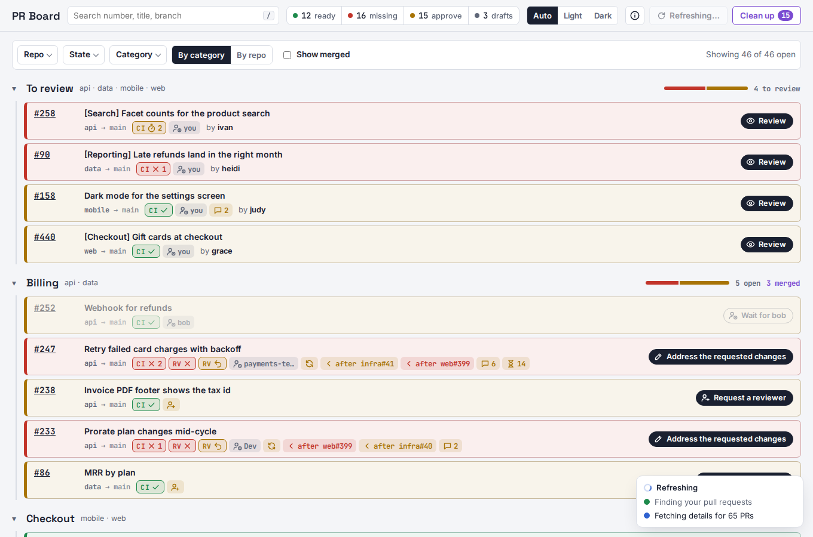

# The page

Everything the page shows, and why. Real screenshots of the demo board are [at the end](#screenshots).

The colour is the row's left bar:

| Colour | Meaning |
|---|---|
| green | Ready to merge: not a draft, approved, every check passed and none running, mergeable, not behind, no branch rule blocking, no changes requested, no required PR still open |
| yellow | Ready to approve: not a draft and everything above is in place except an approval |
| red | Something missing: any other open PR (draft, CI failing or running, conflicts, behind, changes requested, a branch rule, a required PR still open); the icons say what. A draft keeps the red bar, dashed, but is counted as a draft, not as something missing |
| purple | Merged, until Clean up removes it |

Each open row puts the number on the left (a DRAFT tag under it on drafts) and the title first, on up to two lines (the full title in its tooltip). Under the title come the repository and the branch it merges into (`web → main`), the `after #N` label of a chain and one signals row that never wraps (signals that do not fit fold into a `+N` chip whose tooltip names each hidden one and its detail). The next step sits on the right as a chip (see [Next step](#next-step)). Hovering a row lifts it and names its state. A draft's left bar is dashed. Merged rows are shorter and purple. Under 700px wide the next step moves below the signals. The info button in the command bar opens the legend drawer, which lists the colours, the rows, the group mix bar, every next step, every signal in row order and the chains. The Auto / Light / Dark switch next to it sets the theme: Auto follows the system, the other two are remembered in the browser.

The command bar stays at the top of the window while you scroll: the name with the open count and the last refresh time, the search, the counters, the theme switch, the legend, Refresh and Clean up. The counters are one segmented control (`● 2 ready │ ● 5 missing │ ● 3 approve │ ● 3 drafts`), in order of importance: your open PRs per colour, with drafts apart in a muted fourth counter and out of the red one; clicking one toggles it in the State filter, which has a Drafts choice too, and the full name is in its tooltip. As the window narrows the bar drops the summary line, then the counters' words, then the Refresh and Clean up labels; under 700px it takes three lines. Each group's mix bar splits its rows the same way, in the same order. The tab title shows how many are ready to merge, `(2) PR Board`. Clean up shows the number of merged PRs it would clear as a badge, and is disabled when there are none.

While a refresh runs, the button's or the server's own every 5 minutes, a card in the bottom-right corner lists its steps as they come (`Finding your pull requests`, `Fetching details for 14 PRs`, `Checking required PRs`), the current one marked and the earlier ones ticked. When it ends the card says "Updated just now", the board reloads and the card hides; while it shows, the page gets extra room at the bottom so the card never covers the last row. The page asks for the step every 1.5 seconds, so a step shorter than that can be missed.

## Groups

By default the rows are grouped by category: the first token in square brackets in the title (`[Checkout]`, `[Design system]`), each bracket split on `|`, skipping the repository's own name (`[web]`), issue keys (`[WEB-123]`) and `required:` lists. Categories are listed alphabetically and PRs without one go in **Untagged**, last. Each group's heading shows the category, the repositories it spans, a thin bar of its status mix (one segment per counter, in counter order; the exact counts are in its tooltip), how many PRs are open and how many merged PRs are on the board; inside it the rows drop their own `[Category]` tag from the title.

The By category / By repo switch in the filter bar groups them per repository instead: the heading shows `owner/repo → branch`, the mix bar, the open count and how many merged PRs are on the board, each row shows only `→ branch`, and the category is a pill after the signals. Click a heading to collapse its group.

## To review

Open PRs by others that request your review (`review-requested:@me` in the configured owners) sit in their own group above the others, in both views: number, title, repository, signals, the author and a Review step, always your move. The heading states how many there are; they are not in the colour counters or the "Showing N of M" count, never join a chain, and Clean up never touches them. When the review is no longer requested or the PR closes, it leaves the board on the next refresh.

## Chains

A PR waits on another when its base is that PR's branch (a stack, same repository) or when its description requires an open PR on the board (`[required:...]`, any repository; when several qualify, the first). It is shown right under that PR, indented, with an elbow and an `after #412` or `after repo#90` label, and the required chip it would have repeated is dropped. When the PR it waits on is in another group, it stays in its own group with the label and no elbow.

The signals always come in the same order, so each one sits in the same place on every row. Each has a tooltip with the detail (which jobs fail, who approved, who dismissed):

| Signal | Shows |
|---|---|
| CI | the letters `CI` with a check (green), a cross and the failing count (red) or a stopwatch and the running count (amber) |
| Review | the letters `RV` with a check (approved), a cross (changes requested) or an undo arrow (approval dismissed); always right after CI, and both letter chips have a border in their colour so the two read apart |
| Reviewer | a person with a plus (no reviewer requested), or a person with a clock and the requested login or team, cut at about 12 characters |
| Conflicts | two branches joining, with a cross |
| Behind | sync arrows |
| Branch rule | a shield with a cross: approved and green, but a rule still blocks the merge |
| Required PRs | a left chevron and `after #412` or `after repo#90`, for requirements that are not a chain (see below) |
| Threads | a speech bubble and the count of unresolved threads |
| Stale | an hourglass and the days since the last update, after 10 |

## Next step

Every open row ends in a chip that says what happens next, with an icon per kind. It is solid when the step is yours and outlined when you wait; a row where you wait fades its content until you hover it or focus something in it, so the rows you can act on stand out. Screens without hover (touch) do not fade.

| Icon | Next step | Whose move |
|---|---|---|
| merge arrows | merge | yours |
| branches with a cross | merge the base branch (conflicts) | yours |
| pencil | address the requested changes | yours |
| wrench | fix failing CI | yours |
| flag | mark ready when you want review (a draft) | yours |
| person with a plus | request a reviewer | yours |
| sync arrows | update from the base branch | yours |
| shield | check which branch rule blocks it on GitHub | yours |
| warning triangle | a required PR was closed without merging, or is not found | yours |
| check in a circle | get an approval | yours |
| eye | review (a PR that asks for your review) | yours |
| chain link | merge #412 first: a required PR is still open | you wait |
| clock | wait for CI | you wait |
| person with a clock | wait for the requested reviewers | you wait |
| refresh arrow | refresh: GitHub is still computing mergeability | you wait |

The server sets the kind next to the step (`next_kind` and `your_move` in `/api/prs`), so the page never guesses it from the words.

## Filters

The search in the command bar (`/` focuses it, Escape leaves it) looks in number, title and branch. The bar under it filters the rows on the page: Repo, State and Category (with "No category") multi-selects, and a Show merged switch (off by default; each group then gets a "N merged" fold that opens its merged rows). A chain is shown whole when any PR in it matches, with the others dimmed, so the merge order stays visible; a group with nothing left hides. "Showing N of M open" counts the matching open PRs, and Clear resets everything.

The filters, the grouping and the collapsed groups live in the URL fragment, so a link reproduces the view:

```text
http://127.0.0.1:<port>/#state=missing,approve&repo=web&q=checkout&cat=Checkout&merged=1&group=repo&rfold=infra
```

State values are `ready`, `missing`, `approve` and `draft` (`missing` leaves drafts out); `cat=~none` is "No category". `group=repo` is the repository view (absent: by category). `fold` lists the collapsed category groups (`~none` is Untagged) and `rfold` the collapsed repository groups. Clear resets the filters and keeps the grouping and the collapsed groups.

## Required PRs

Name the PRs that must merge first anywhere in the description, outside fenced code:

```text
[required:acme/infra#478, acme:design-system#12, api#4021, #4543]
```

`owner/repo#N` and `owner:repo#N` are full references, `repo#N` uses the PR's owner, `#N` its repository. The keyword is case-insensitive, several blocks merge, and malformed items are skipped. An open PR on the board, in any repository, becomes the row's parent (see Chains; when several qualify, the first one, and the rest stay chips). Every other requirement is a chevron chip, "after repo#N", coloured by the target's state, which the collector looks up with one extra GraphQL query when the target is not on the board: green when merged, amber when open, red when closed without merging, amber "not found" when GitHub does not know it. Any requirement that is not merged makes the row red with "merge #N first".

## Screenshots

All screenshots come from `pr-board demo`, a fictional organization.



