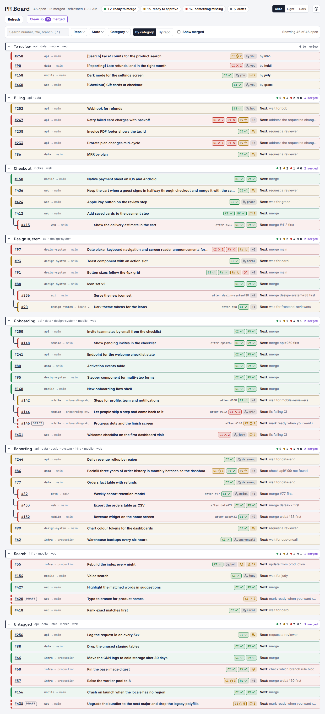
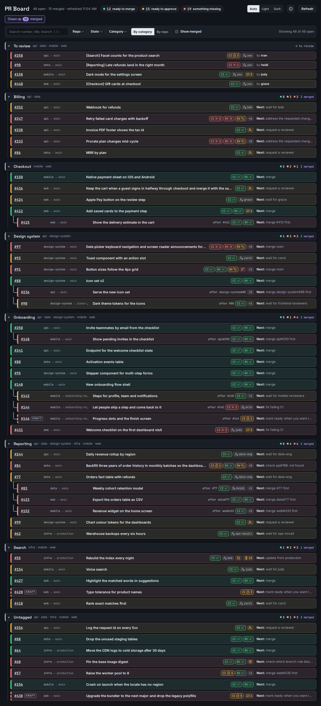
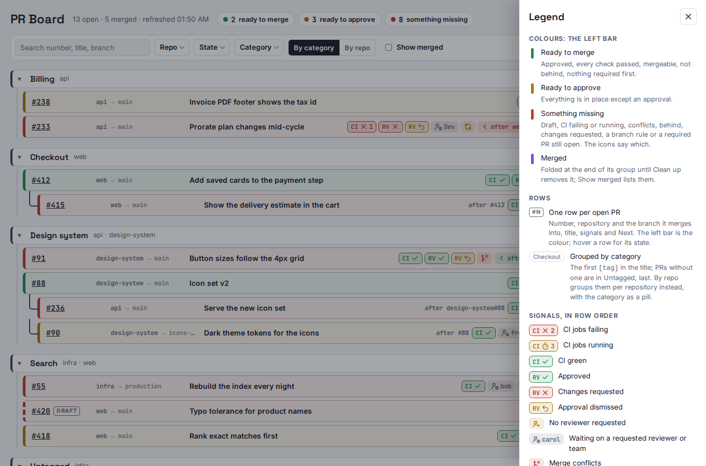
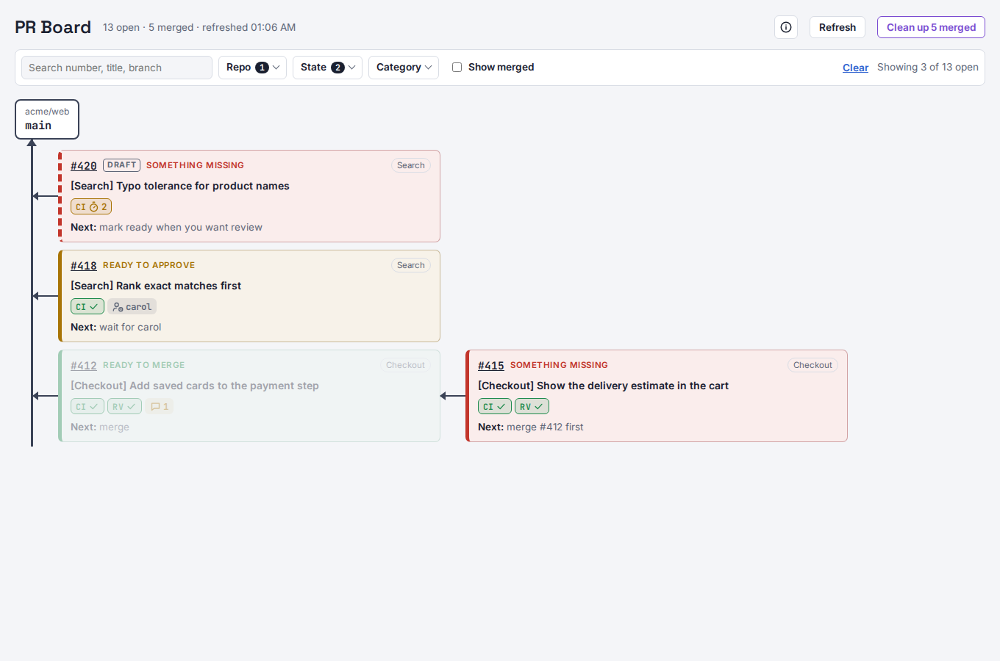
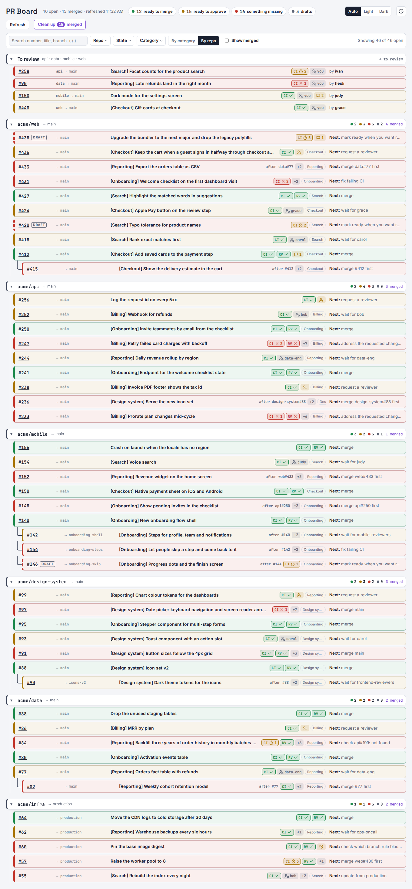

# The page

Everything the page shows, and why. Real screenshots of the demo board are [at the end](#screenshots).

The colour is the row's left bar:

| Colour | Meaning |
|---|---|
| green | Ready to merge: not a draft, approved, every check passed and none running, mergeable, not behind, no branch rule blocking, no changes requested, no required PR still open |
| yellow | Ready to approve: not a draft and everything above is in place except an approval |
| red | Something missing: any other open PR (draft, CI failing or running, conflicts, behind, changes requested, a branch rule, a required PR still open); the icons say what. A draft keeps the red bar, dashed, but is counted as a draft, not as something missing |
| purple | Merged, until Clean up removes it |

Every open row has the same height and five columns: the number (a DRAFT tag on drafts), the repository and the branch it merges into (`web → main`), the title on one line (the full title in its tooltip), one signals row at most 220px wide that never wraps (signals that do not fit fold into a `+N` chip whose tooltip names each hidden one and its detail) and the Next step. Hovering a row lifts it and names its state. A draft's left bar is dashed. Merged rows are shorter and purple. Under 700px wide each row takes two lines: number, repository and title, then signals and Next. The info button in the header opens the legend drawer, which lists the colours, the rows, every signal in row order and the chains. The Auto / Light / Dark switch next to it sets the theme: Auto follows the system, the other two are remembered in the browser.

The counters in the header (`● 2 ready to merge ● 5 something missing ● 3 ready to approve ● 3 drafts`), in order of importance, count your open PRs per colour, with drafts apart in a muted fourth counter and out of the red one; clicking one toggles it in the State filter, which has a Drafts choice too. Each band's dots split its rows the same way, in the same order. The tab title shows how many are ready to merge, `(2) PR Board`. Clean up shows the number of merged PRs it would clear as a badge, and is disabled when there are none.

## Groups

By default the rows are grouped by category: the first token in square brackets in the title (`[Checkout]`, `[Design system]`), each bracket split on `|`, skipping the repository's own name (`[web]`), issue keys (`[WEB-123]`) and `required:` lists. Categories are listed alphabetically and PRs without one go in **Untagged**, last. Each band shows the category, the repositories it spans, its colour counts and how many merged PRs are on the board; inside it the rows drop their own `[Category]` tag from the title. A band stays at the top of the window while you scroll through its group.

The By category / By repo switch in the filter bar groups them per repository instead: the band shows `owner/repo → branch`, the colour counts and how many merged PRs are on the board, each row shows only `→ branch`, and the category is a pill after the signals. Click a band to collapse it.

## To review

Open PRs by others that request your review (`review-requested:@me` in the configured owners) sit in one compact band above the groups, in both views: number, repository, title, signals and the author. The band states how many there are; they are not in the colour counters or the "Showing N of M" count, never join a chain, and Clean up never touches them. When the review is no longer requested or the PR closes, it leaves the board on the next refresh.

## Chains

A PR waits on another when its base is that PR's branch (a stack, same repository) or when its description requires an open PR on the board (`[required:...]`, any repository; when several qualify, the first). It is shown right under that PR, indented, with an elbow and an `after #412` or `after repo#90` label, and the required chip it would have repeated is dropped. When the PR it waits on is in another group, it stays in its own group with the label and no elbow.

The signals always come in the same order, so each one sits in the same place on every row. Each has a tooltip with the detail (which jobs fail, who approved, who dismissed):

| Signal | Shows |
|---|---|
| CI | the letters `CI` with a check (green), a cross and the failing count (red) or a stopwatch and the running count (amber) |
| Review | the letters `RV` with a check (approved), a cross (changes requested) or an undo arrow (approval dismissed); always right after CI, and both letter chips have a border in their colour so the two read apart |
| Reviewer | a person with a plus (no reviewer requested), or a person with a clock and the requested login or team, cut at about 12 characters |
| Conflicts | two branches joining, with a cross |
| Behind | sync arrows |
| Branch rule | a shield with a cross: approved and green, but a rule still blocks the merge |
| Required PRs | a left chevron and `after #412` or `after repo#90`, for requirements that are not a chain (see below) |
| Threads | a speech bubble and the count of unresolved threads |
| Stale | an hourglass and the days since the last update, after 10 |

## Filters

The bar under the header filters the rows on the page: a search over number, title and branch (`/` focuses it, Escape leaves it), Repo, State and Category (with "No category") multi-selects, and a Show merged switch (off by default; each group then gets a "N merged" fold that opens its merged rows). A chain is shown whole when any PR in it matches, with the others dimmed, so the merge order stays visible; a group with nothing left hides. "Showing N of M open" counts the matching open PRs, and Clear resets everything.

The filters, the grouping and the collapsed groups live in the URL fragment, so a link reproduces the view:

```text
http://127.0.0.1:<port>/#state=missing,approve&repo=web&q=checkout&cat=Checkout&merged=1&group=repo&rfold=infra
```

State values are `ready`, `missing`, `approve` and `draft` (`missing` leaves drafts out); `cat=~none` is "No category". `group=repo` is the repository view (absent: by category). `fold` lists the collapsed category bands (`~none` is Untagged) and `rfold` the collapsed repository bands. Clear resets the filters and keeps the grouping and the collapsed bands.

## Required PRs

Name the PRs that must merge first anywhere in the description, outside fenced code:

```text
[required:acme/infra#478, acme:design-system#12, api#4021, #4543]
```

`owner/repo#N` and `owner:repo#N` are full references, `repo#N` uses the PR's owner, `#N` its repository. The keyword is case-insensitive, several blocks merge, and malformed items are skipped. An open PR on the board, in any repository, becomes the row's parent (see Chains; when several qualify, the first one, and the rest stay chips). Every other requirement is a chevron chip, "after repo#N", coloured by the target's state, which the collector looks up with one extra GraphQL query when the target is not on the board: green when merged, amber when open, red when closed without merging, amber "not found" when GitHub does not know it. Any requirement that is not merged makes the row red with "merge #N first".

## Screenshots

All screenshots come from `pr-board demo`, a fictional organization.










